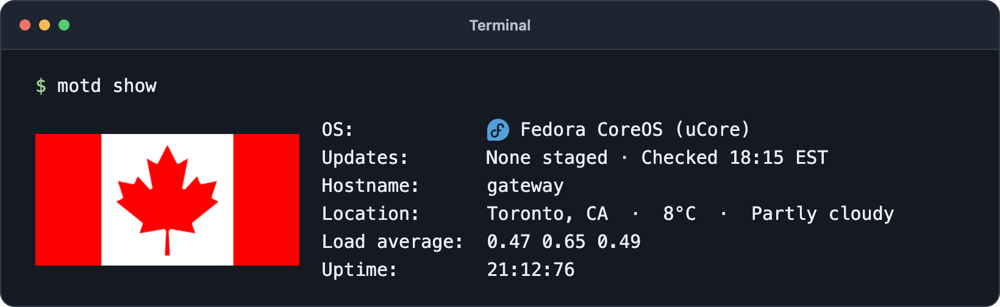

# ironicbadger/motd

A configurable login banner for Linux and macOS. Show your host, system stats, and local weather with a distro logo or flag.



## Quick start 

Download the binary for your OS and architecture, rename it to `motd`, run `chmod +x motd`, and put it on your `PATH`. [Releases](https://github.com/ironicbadger/motd/releases)

Run `motd --version` to check the installed release. Development builds from a Git checkout report the commit and mark local changes with `.dirty`.

Or install with Go 1.25 or later:

```sh
go install github.com/ironicbadger/motd/cmd/motd@latest
```

Make sure your Go binary directory (`go env GOBIN`, or `$(go env GOPATH)/bin` when unset) is on your `PATH`.

```sh
motd show
```

`motd show` reads local system data and cached readings, so it works offline. Ghostty and Kitty show inline artwork. Other color terminals use ANSI art. Use `-ansi` to force ANSI or `-color never` for plain text. Preview flags with `motd flags`.

## Show the banner on Linux SSH login

For Bash, copy [the SSH hook](contrib/motd-ssh.sh) to `~/.config/motd/ssh.sh`. Source it after setting your `PATH` in your existing login startup file. Bash reads the first of `~/.bash_profile`, `~/.bash_login`, and `~/.profile` that exists and is readable.

```sh
. "$HOME/.config/motd/ssh.sh"
```

For all users, install the hook under `/etc/profile.d/` on distributions that source that directory. Use one installation method to avoid printing the banner twice. The hook checks for an interactive shell, an SSH TTY, and terminal output, so SSH remote commands and file transfers receive no banner.

## Configure

Start with the [annotated example](config.example.toml) or the [minimal example](config.minimal.toml). Save it as `motd/config.toml` under your user config directory.

| Platform | User config directory |
| --- | --- |
| Linux | `$XDG_CONFIG_HOME`, or `~/.config` |
| macOS | `~/Library/Application Support` |

Both `show` and `refresh` accept `-config FILE` and `-cache FILE`. For a per-user install, schedule `motd refresh` as that user, for example every 20 minutes. Per-user and custom cache paths have private files.

For a system-wide Linux install, put the binary at `/usr/local/bin/motd` and the config at `/etc/motd.toml`. Install the service and timer files under `/etc/systemd/system/`. [Service file](contrib/motd-refresh.service) · [Timer file](contrib/motd-refresh.timer)

```sh
sudo systemctl daemon-reload
sudo systemctl enable --now motd-refresh.timer
sudo systemctl start motd-refresh.service
```

The system service writes `/var/cache/motd/cache.json` so regular users can read cached weather and update status. MOTD skips public IPv4 lookups and omits the address for that shared path. A per-user config takes precedence and uses its own cache by default.

The Updates row uses local rpm-ostree status or APT’s cached package indexes, depending on the host. MOTD refresh does not update package indexes or install packages. Missing and expired readings are omitted. CPU temperature appears on Linux hosts with a supported sensor. [Open-Meteo](https://open-meteo.com/) · [ipify](https://www.ipify.org/)

## Build from source

With Go 1.25 or later, run `CGO_ENABLED=0 go build -trimpath -o motd ./cmd/motd`. Run checks with `go test ./...` and `go vet ./...`.

GitHub Actions runs tests, vet, and builds on Linux and macOS for pushes and pull requests. Pushing a version tag such as `v0.1.0` also publishes Linux and macOS binaries for amd64 and arm64, plus SHA-256 checksums, to GitHub Releases.

Artwork from [Flagcdn](https://flagcdn.com/) and [Simple Icons](https://simpleicons.org/). ANSI artwork rendered with [Chafa](https://hpjansson.org/chafa/).
