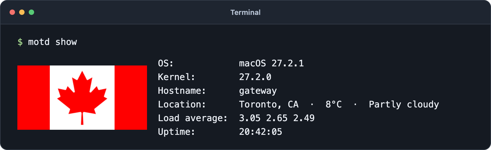

# motd

A configurable login banner for Linux and macOS. Show your host, system stats, and local weather with a distro logo or flag.



## Quick start 

Download the binary for your OS and architecture, rename it to `motd`, run `chmod +x motd`, and put it on your `PATH`. [Releases](https://github.com/ironicbadger/motd/releases)

Or install with Go 1.25 or later:

```sh
go install github.com/ironicbadger/motd/cmd/motd@latest
```

Make sure your Go binary directory (`go env GOBIN`, or `$(go env GOPATH)/bin` when unset) is on your `PATH`.

```sh
motd show
```

Add `motd show` to your interactive login hook. It reads local system data and cached readings, so it works offline. Ghostty and Kitty show inline artwork. Other color terminals use ANSI art. Use `-ansi` to force ANSI or `-color never` for plain text. Preview flags with `motd flags`.

## Configure

Start with the [annotated example](config.example.toml) or the [minimal example](config.minimal.toml). Save it as `motd/config.toml` under your user config directory.

| Platform | User config directory |
| --- | --- |
| Linux | `$XDG_CONFIG_HOME`, or `~/.config` |
| macOS | `~/Library/Application Support` |

Both `show` and `refresh` accept `-config FILE` and `-cache FILE`.

Run `motd refresh` as the same user from a timer or cron, for example every 20 minutes. It caches weather, public IPv4 when enabled, and local rpm-ostree update status. Missing and expired readings are omitted. CPU temperature appears on Linux hosts with a supported sensor. [Open-Meteo](https://open-meteo.com/) · [ipify](https://www.ipify.org/)

## Build from source

With Go 1.25 or later, run `CGO_ENABLED=0 go build -trimpath -o motd ./cmd/motd`. Run checks with `go test ./...` and `go vet ./...`.

GitHub Actions runs tests, vet, and builds on Linux and macOS for pushes and pull requests. Pushing a version tag such as `v0.1.0` also publishes Linux and macOS binaries for amd64 and arm64, plus SHA-256 checksums, to GitHub Releases.

Artwork from [Flagcdn](https://flagcdn.com/) and [Simple Icons](https://simpleicons.org/). ANSI artwork rendered with [Chafa](https://hpjansson.org/chafa/).
